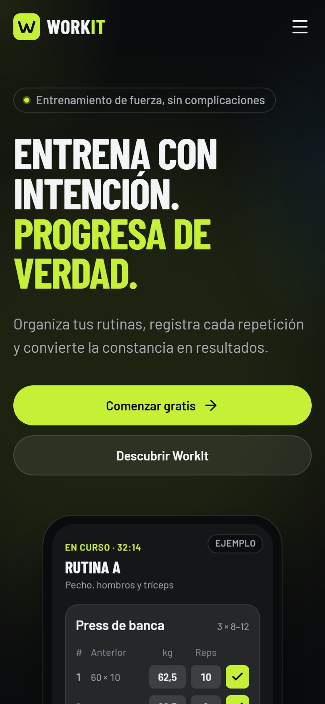
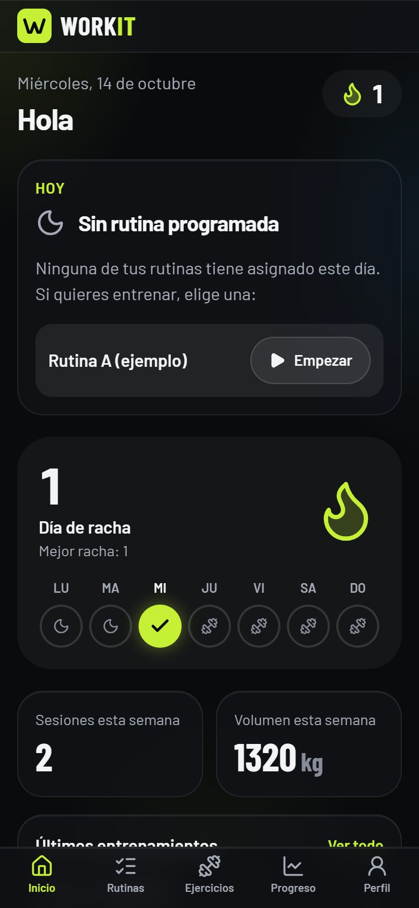
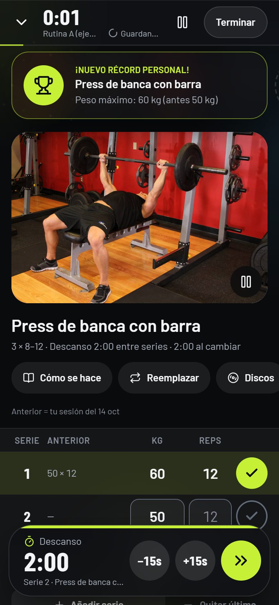
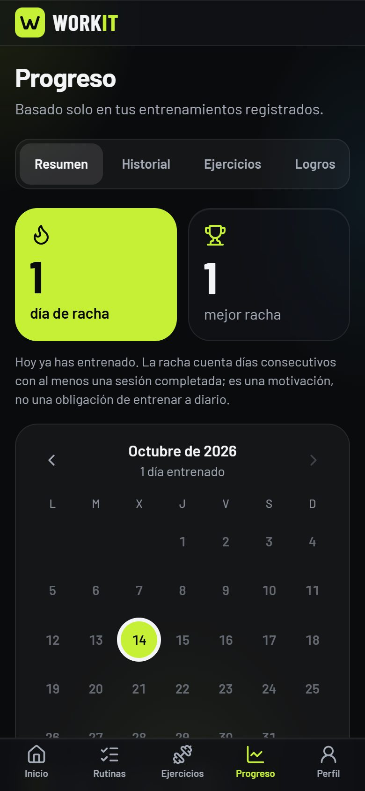
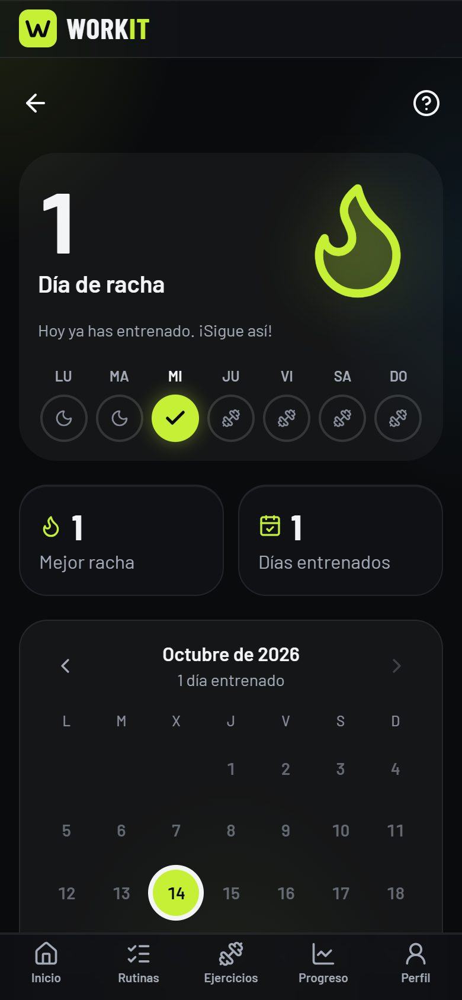
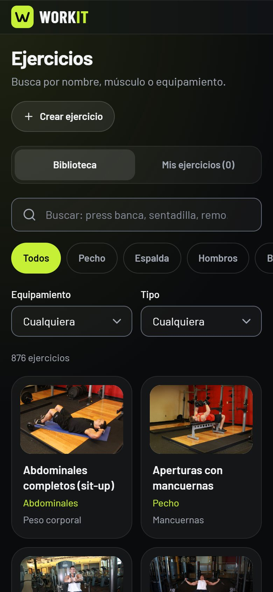

<div align="center">


# WorkIt

**Entrena con intención. Progresa de verdad.**

Aplicación web instalable (PWA) para organizar tus rutinas de gimnasio, registrar cada serie en vivo
y seguir tu progreso y tus rachas, en español y pensada para el móvil.

<a href="https://app-workit.netlify.app/"></a>


[Funciones](#-funciones) · [Capturas](#-capturas) · [Tecnologías](#-tecnologías) · [Empezar](#-empezar) · [Seguridad](#-seguridad) · [Créditos](#-créditos)

</div>

---

## 📸 Capturas

<table>
  <tr>
    <td align="center" width="33%"><br /><sub><b>Inicio</b></sub></td>
    <td align="center" width="33%"><br /><sub><b>Panel y racha semanal</b></sub></td>
    <td align="center" width="33%"><br /><sub><b>Entrenamiento en vivo y récord</b></sub></td>
  </tr>
  <tr>
    <td align="center"><br /><sub><b>Mapa de músculos trabajados</b></sub></td>
    <td align="center"><br /><sub><b>Rachas</b></sub></td>
    <td align="center"><br /><sub><b>Biblioteca de ejercicios</b></sub></td>
  </tr>
</table>

## ✨ Funciones

### 🏋️ Entrenamiento en vivo
- Vista centrada en el ejercicio actual, con imagen grande y carrusel para saltar entre ejercicios.
- Series con peso y repeticiones prellenados con lo que hiciste la última vez; series de calentamiento.
- **Temporizador de descanso** entre series y entre ejercicios, con **±15 s** sobre la marcha.
- Aviso al terminar el descanso: **campana de ring**, cuenta atrás 3‑2‑1, destello en pantalla y vibración (configurables).
- **Récord en vivo**: si superas tu mejor marca, la app lo celebra en el momento.
- Calculadora de discos, cambio de ejercicio a mitad de sesión y pausa.
- Guardado local y en la nube: si recargas o pierdes la conexión, no pierdes la sesión.

### 📋 Rutinas y programas
- Crea rutinas con series, rango de repeticiones, peso y descansos, y asígnalas a días de la semana.
- Vista previa de la rutina con duración estimada y distribución muscular.
- **Programas listos para usar**: Push Pull Legs, Torso / Pierna, Full Body y Mancuernas y banco.
- Sugerencias de progresión según tus sesiones anteriores.

### 📚 Biblioteca de ejercicios
- **876 ejercicios** con imágenes, instrucciones y filtros por músculo, equipamiento y tipo.
- Búsqueda en español (por ejemplo, «press banca» o «sentadilla»).
- Ejercicios propios.
- Ficha de cada ejercicio con tu historial, **1RM estimado** y **récords por repeticiones**.

### 📈 Progreso
- Sesiones y volumen por semana, calendario de actividad y gráficos por ejercicio.
- **Mapa del cuerpo** (frente y espalda) coloreado según las series por músculo de los últimos 7 o 30 días.
- Historial completo: puedes editar o borrar entrenamientos ya terminados y registrar sesiones pasadas.
- Logros calculados a partir de tu historial.

### 🔥 Rachas
- Racha de días seguidos con vista de la semana, calendario y mejor racha.
- **Modo flexible**: los días de descanso que tenías planeados no rompen la racha, pero tampoco cuentan como entrenados.

### 📱 App instalable
- Se instala en la pantalla de inicio del iPhone o Android y funciona a pantalla completa: abre [app-workit.netlify.app](https://app-workit.netlify.app/) y elige *Añadir a pantalla de inicio* (Safari: botón Compartir).
- Precarga de la app y de la biblioteca; las imágenes quedan en caché para usarlas en el gimnasio.
- Aviso cuando hay una versión nueva.
- Diseño oscuro con efecto vidrio, pensado para usarse con una mano.

## 🛠️ Tecnologías

| Área | Herramientas |
|---|---|
| Interfaz | React 19, TypeScript, React Router, Tailwind CSS 4, Lucide, Recharts |
| Datos y cuentas | Firebase Authentication (correo y Google) y Cloud Firestore |
| App instalable | vite-plugin-pwa (Workbox) |
| Calidad | Vitest, oxlint y pruebas de Security Rules con el emulador de Firestore |
| Despliegue | Netlify |

## 🚀 Empezar

**Requisitos:** Node.js 24.12 o superior (lo exige el SDK de Firebase 13), npm 10 o superior y un proyecto de Firebase. La configuración está explicada paso a paso en [`docs/FIREBASE.md`](docs/FIREBASE.md).

```bash
git clone https://github.com/jesuguerreroc/WorkIt.git
cd WorkIt
npm install
cp .env.example .env.local   # rellena las variables de Firebase
npm run dev                  # http://localhost:5173
```

<details>
<summary><b>Scripts disponibles</b></summary>

| Script | Qué hace |
|---|---|
| `npm run dev` | Servidor de desarrollo |
| `npm run build` | Comprobación de tipos y build de producción en `dist/` |
| `npm run preview` | Sirve el build de producción |
| `npm run typecheck` | Solo TypeScript |
| `npm run lint` | oxlint |
| `npm test` | Tests unitarios (Vitest) |
| `npm run test:rules` | Pruebas de las Security Rules en el emulador (requiere Java 21) |
| `npm run emulators` | Emuladores locales de Auth y Firestore |
| `npm run deploy:rules` | Publica `firestore.rules` en el proyecto de `.firebaserc` |

</details>

<details>
<summary><b>Variables de entorno</b></summary>

Ver [`.env.example`](.env.example). Todas las variables `VITE_*` acaban en el código que se envía al navegador, así que solo puede ir configuración pública.

| Variable | Necesaria | Uso |
|---|---|---|
| `VITE_FIREBASE_*` (6) | Sí | Configuración de la app web de Firebase |
| `VITE_USE_FIREBASE_EMULATORS` | No | `true` conecta la app a los emuladores locales |
| `VITE_CONTACT_EMAIL` | No | Muestra un enlace de contacto en el pie |

</details>

<details>
<summary><b>Probar sin tocar el proyecto real (emuladores)</b></summary>

```bash
npm run emulators                                # terminal 1 (UI en http://127.0.0.1:4000)
VITE_USE_FIREBASE_EMULATORS=true npm run dev     # terminal 2
# En PowerShell: $env:VITE_USE_FIREBASE_EMULATORS="true"; npm run dev
```

Las cuentas y los datos creados así solo existen en tu máquina.

</details>

<details>
<summary><b>Desplegar en Netlify</b></summary>

El repositorio incluye [`netlify.toml`](netlify.toml) con el comando de build, Node 24 y la redirección para la SPA. En Netlify, añade las variables `VITE_FIREBASE_*` en *Site configuration → Environment variables*. Cada `git push` a `main` publica una nueva versión.

</details>

## 🔐 Seguridad

- **No hay secretos en el frontend.** La configuración web de Firebase es pública por diseño; los datos los protegen las [Security Rules](firestore.rules).
- Cada usuario solo puede leer y escribir sus propios datos, y cada campo se valida en las reglas.
- Las reglas tienen pruebas automáticas ([`tests/rules`](tests/rules/firestore.rules.test.ts)) que se ejecutan contra el emulador antes de publicarlas.

## 📁 Estructura

```
src/
  app/            router, guardas de rutas, estado de la app
  components/     UI reutilizable (botones, diálogos, campos) y layout
  features/
    auth/         registro, inicio de sesión (correo y Google), recuperación
    dashboard/    panel principal
    exercises/    biblioteca, búsqueda, ficha y ejercicios propios
    routines/     rutinas: lista, vista previa y editor
    programs/     programas listos para usar
    workouts/     entrenamiento en vivo, descansos, récords y discos
    progress/     gráficos, historial, calendario y mapa del cuerpo
    streaks/      rachas y logros
    profile/      perfil, preferencias y avisos
    landing/      página de inicio pública
  services/       acceso a Firebase
  lib/            utilidades (fechas, números, entorno)
  types/          modelos de datos
tests/rules/      pruebas de las Security Rules
docs/             DESIGN.md · DATA.md · FIREBASE.md · capturas
```

Más detalle en [`docs/DESIGN.md`](docs/DESIGN.md) (diseño y accesibilidad), [`docs/DATA.md`](docs/DATA.md) (modelo de datos) y [`docs/FIREBASE.md`](docs/FIREBASE.md) (configuración).

## 🙌 Créditos

- **Ejercicios e imágenes:** [Free Exercise DB](https://github.com/yuhonas/free-exercise-db), de dominio público (Unlicense). Se usa una versión fija, con nombres traducidos y revisados en español.
- **Iconos:** [Lucide](https://lucide.dev).
- **Tipografías:** Barlow y Barlow Condensed (SIL Open Font License).
- **Sonidos y mapa del cuerpo:** creados para WorkIt. La campana se genera con Web Audio y la silueta es un SVG propio.

<div align="center">
<br />
<sub>Hecho con 💪 por <a href="https://github.com/jesuguerreroc">Jesus Guerrero</a></sub>
</div>
